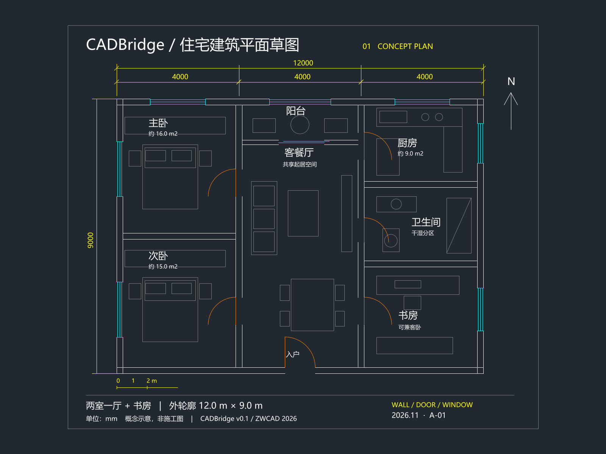

# CADBridge · Codex 插件 CAD

连接 AI Agent 与 CAD 的共享自动化桥接工具。第一版仅交付 **Codex 接入**，以 **中望 CAD 2026 教育版**完成实机验证，保留上游 AutoCAD / ZWCAD / GstarCAD / BricsCAD 的兼容 COM 适配结构。

版本：**v0.1.0**，Windows、Python 3.12+。运行时、上游源码、插件清单、Skills、安装脚本、测试和示例均在本仓库；不需要另行克隆上游项目。依赖安装需要网络，仓库不包含 CAD 软件或离线 Python 依赖包。



## 安装

先安装 Python 3.12+（Windows `py` 启动器）或 uv、Git，以及可用的 Codex CLI。打开已安装的 CAD，与 Codex 使用同一 Windows 账户和权限级别。

```powershell
git clone https://github.com/2729930431-afk/AgentCADBridge.git
cd AgentCADBridge
powershell -NoProfile -ExecutionPolicy Bypass -File .\scripts\install.ps1
```

安装脚本创建本地 Python 环境，按锁文件安装依赖，生成仅含宿主配置/Skills/图标的本地插件包，再用 Codex CLI 注册市场并安装启用。**重启 Codex，开启新聊天，插件显示名称为 CAD**，技术标识为 `cad@agent-cad-bridge-local`，MCP Server 为 `cad_bridge`。

保留仓库和 `.venv`：已安装的薄适配包通过绝对路径调用这里的共享业务核心。移动仓库后重新运行安装脚本。`-Dev` 同时安装测试工具；`-SkipCodex` 只安装依赖并生成插件包，在输出的市场路径手动注册。源码清单是分发模板，推荐使用安装脚本生成当前机器的实际 MCP 启动路径，不要直接复制缓存配置给其他机器。

更新：在原目录 `git pull` 后重新运行安装脚本并重启 Codex。卸载插件：`codex plugin remove cad@agent-cad-bridge-local`；它不会删除本地源代码、图纸和执行记录。

## 公开接口

三个数量分别统计，不能相加后当作功能总数。精确清单见 [机器生成的接口目录](docs/inventory.json)，可用 `python scripts/inventory.py --check` 检查。

| 层次 | 数量 | 内容 |
|---|---:|---|
| MCP 工具入口 | **8** | connect、capabilities、catalog、documents、execute、batch、preview、request_status |
| catalog 业务操作 | **56** | 通过 cad_execute / cad_batch 调用 |
| 文档管理动作 | **7** | list、new、open、activate、inspect、save、close |
| 打包分发的 Skills | **4** | 连接、图纸理解、绘图编辑、开发维护 |

| 业务域 | 操作数量 |
|---|---:|
| 绘图、文字、尺寸与表格 | 13 |
| 实体属性与变换 | 11 |
| 图层管理 | 12 |
| 图块与属性 | 8 |
| 查询与数据导出 | 7 |
| 视图、撤销重做、文字样式 | 5 |

操作签名与参数由 `cad_catalog(operation="draw_line")` 动态提供 JSON Schema。MCP 工具聚合结构减少客户端一次加载的工具数量；56 个操作不代表每个操作都已在四家 CAD 上验证。

## Skill 体系

这是一个覆盖首版日常任务闭环的基础体系，尚不包含机械 BOM、专业制图规范和施工审查流程。

| Skill | 职责与衔接 |
|---|---|
| **cad-connect** | 连接与诊断 → 识别 CAD、文档与单位 → 绑定 document_id |
| **cad-inspect** | 理解现有图纸 → 分页查询实体、图层、图块与属性 → 确定修改对象或导出数据 |
| **cad-draw** | 创建与编辑 → 批处理与错误恢复 → 后台预览核验 → 另存结果 |
| **cad-develop** | 维护与扩展 → 约束多 CAD / 多 Agent 边界、能力差异、测试和分发 |

所有流程共享显式文档绑定、能力查询、请求记录和失败后核验规则；预览、保存和结果验证已纳入绘图工作流，并非仅按工具名称堆积 Skill。

## 后台预览

`cad_preview(document_id)` 通过 **共享 COM Document.Export → DXF 快照 → ezdxf/Matplotlib Agg → PNG/SVG** 返回图纸图片。支持尚未保存的几何内容、深浅背景和指定像素尺寸，无需截屏或切换窗口。工具直接返回 MCP 图片内容，同时提供结果文件路径和元数据。

这是二维 DXF 渲染，特殊字体、SHX、代理对象、外部参照和复杂三维可能与 CAD 原生显示不同。[完整说明及兼容范围](docs/preview.md)。

## 架构与扩展规则

```text
Codex 插件（清单 / 安装 / Skills）
    ↓
共享 MCP 接口 → 共享业务核心（校验 / 文档绑定 / 调度 / 请求记录）
    ↓
CADBackend 契约
    ├─ 共享兼容 COM 实现 + 四种 CAD 配置
    └─ 未来的原生 / RPC / 专业能力后端

DXF 快照 → 共享后台渲染器 → PNG / SVG
```

**所有新增功能必须沿用上游多 CAD 共享适配结构。** 优先共享实现与配置复用；无法通用的接口通过后端契约和能力门控隔离，明确返回不支持及实际限制。不得在 MCP/业务层增加中望专用捷径，不得用中望实测代替其他 CAD 的兼容验收。

这条规则写入了随插件安装的 [cad-develop Skill](skills/cad-develop/SKILL.md)、MCP 系统说明和根目录 [AGENTS.md](AGENTS.md)，后续 Agent 修改项目时均可读到。

- `cadbridge/server.py`：Codex 使用的 MCP 薄入口。
- `cadbridge/core.py`：共享执行、幂等请求、审计与批处理。
- `cadbridge/backends/`：契约、共享 COM 后端和兼容性修正。
- `cadbridge/preview.py`：与 CAD 品牌无关的渲染器。
- `vendor/multicad/`：固定上游源码快照，不是 Git 子模块；本地适配修改放在 vendor 之外。
- `skills/`、`scripts/`、`docs/`、`tests/`：工作流、安装与诊断、说明和验证。

## 执行保证与限制

- 每个服务使用一个 STA 工作线程；同一用户状态目录下的 CADBridge 进程通过 OS 文件锁串行执行。不能锁住用户手动操作或第三方插件。
- 文档 ID 属于当前 MCP 进程；重连后重新获取。写操作拒绝悄悄切换目标文档。
- 每次写请求使用唯一 request_id；同 ID 同参数返回记录结果，不重复绘图。崩溃后结果不明的请求不会自动重发。
- 批处理先校验全部参数，执行时遇错即停，返回已完成项；Undo Group **不等于事务回滚**。原生命令型 undo/redo 需要查询状态确认。
- 运行状态默认在当前用户 LOCALAPPDATA 下的 `CADBridge` 目录，可由 `CADBRIDGE_STATE_DIR` 指定；不纳入 Git。预览和执行记录会保留在本地。
- 首版提供兼容 COM 的基础业务，保留部分继承能力的版本差异；不提供机械 BOM/ZRX、原生打印、任意 Python/LISP 执行或其他 Agent 的安装包。
- 仅 ZWCAD 2026 有实机记录。AutoCAD、GstarCAD、BricsCAD 为保留的兼容配置，尚未在这些产品上验证。

## 验证与示例

```powershell
powershell -NoProfile -ExecutionPolicy Bypass -File .\scripts\install.ps1 -Dev
.venv\Scripts\python.exe -m pytest -q
.venv\Scripts\python.exe -m ruff check cadbridge scripts tests
.venv\Scripts\python.exe scripts\inventory.py --check
.venv\Scripts\python.exe -m cadbridge doctor
```

自动测试不创建 CAD 图纸。下面两个脚本是**显式实机验收入口**：预览脚本仅使用指定已打开图纸；完整验收脚本创建一张自有测试图，失败也在 finally 中尝试关闭并报告清理结果。

本版本的自动测试、实机功能和后台预览记录见 [v0.1.0 验收记录](docs/verification-v0.1.0.json)。

```powershell
.venv\Scripts\python.exe scripts\preview_live.py '目标图纸.dwg'
.venv\Scripts\python.exe scripts\verify_live.py
```

[住宅草图 DWG](examples/住宅平面草图-v0.1.dwg) 是本项目生成的示例，不是施工图。需要重新生成时显式执行 `.venv\Scripts\python.exe -m cadbridge demo`，每次新建一张图纸并使用新的文件名。安装不会自动运行 Demo。

## 许可证与上游

Apache-2.0。基于 [AnCode666/multiCAD-mcp](https://github.com/AnCode666/multiCAD-mcp)，固定快照 `d724ee4cbc49dffc0f51f61608d02dbc5e1ed3a8`。保留上游许可证、源码及作者信息，详见 [NOTICE](NOTICE)。第三方依赖遵循各自许可证。
